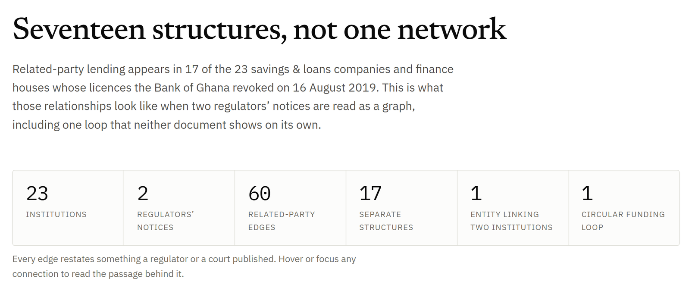
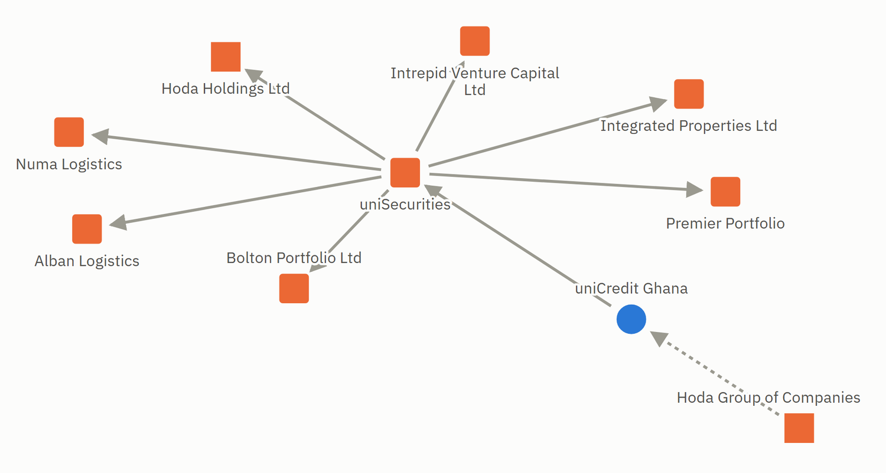

# related-party-lending-network

Modelling the insider relationships behind Ghana's 2019 savings & loans failures as a
network, built from primary sources: what two regulators published, and one court
judgment.

### [Open the map](https://samuelatokwamebaah.github.io/related-party-lending-network/)

<picture>
  <source media="(prefers-color-scheme: dark)" srcset="docs/images/map-headline-dark.png">
  
</picture>

**The headline is a negative result, and it is the honest one.** The documented graph falls
into **17 disconnected components**, the largest holding 10 nodes. There is no single
insider network behind these failures in the public record, so whole-network centrality and
community detection are reported here as the degenerate non-results they are rather than
dressed up as findings. Two things do cross between institutions, and **neither is visible
in either regulator's notice on its own**: one entity connecting two of the 23, and one
closed funding loop.

> **Status: complete at `v0.7`.** All 75 edges have been checked by hand against the
> source that supports them, and the decisions are recorded in `data/verification.csv` and
> versioned in `data/changelog.csv`. Nothing here is a finding about any institution or
> person: it is a record of what two regulators and one court published, with every passage
> quoted and anchored to a line in the source document.

**New here?** Three ways in, in ascending order of detail:

| | |
|---|---|
| [the map](https://samuelatokwamebaah.github.io/related-party-lending-network/) | every connection shows the passage behind it. Rendered from the database by `scripts/build_site.py` into [`index.html`](index.html), which GitHub itself displays as source |
| [docs/LIMITATIONS.md](docs/LIMITATIONS.md) | **what this cannot show, and why.** Read it before the findings, not after |
| [docs/phase2/FINDINGS.md](docs/phase2/FINDINGS.md) | the analyses in full, including the ones that returned nothing |

---

## Why this project

`ghana-banking-collapse` established that **related-party lending appears in 17 of the 23
savings & loans companies and finance houses** whose licences the Bank of Ghana revoked
on 16 August 2019. That is a count. It says how often insider lending appears; it says
nothing about how it was structured, or whether the same people and companies sit behind
more than one failure.

This project asks the structural question. Institutions, their owners, their holding
companies and their connected borrowers are modelled as a graph, so that the shape of the
related-party exposure is visible rather than merely tallied.

It is the third of four repositories in a deliberate arc, each asking a different kind of
question:

| | repository | question | method |
|---|---|---|---|
| 1 | [`ghana-banking-collapse`](https://github.com/SamuelAtokwamebaah/ghana-banking-collapse) | *which* institutions failed, and why | institutional failure analysis over a verified dataset ([DOI](https://doi.org/10.5281/zenodo.22163244)) |
| 2 | [`microfinance-fraud-detection`](https://github.com/SamuelAtokwamebaah/microfinance-fraud-detection) | how much of a repayment-skimming scheme detection would catch | SQL rules and anomaly detection on a synthetic portfolio, not on these institutions |
| 3 | **`related-party-lending-network`** | how insiders were **structurally** connected | network analysis over a cited evidence base |
| 4 | `act-930-resolution-timelines` (published with the article) | how long the regulator left insolvent institutions licensed, and what the statute requires of its timing | a journal paper measuring the interval from the Bank of Ghana's own stated insolvency dates |

The fourth is under peer review. Its repository is published when the article is, so that the
code and the text arrive together rather than the code standing on its own without the argument it
serves.

The third is the one that could most easily have been faked, and that is the point of how
it is built. A network diagram is persuasive whether or not the relationships in it are
real. So every node and every edge here carries a source document and a line number, the
loader refuses to build if a quote is not verbatim, in full, at the line its citation
names, and the analyses that returned nothing are published alongside the ones that did.

## Sourcing standard

- Primary sources: the Bank of Ghana and Securities and Exchange Commission notices, one
  Court of Appeal judgment, UK Companies House records, and the verified dataset in
  `ghana-banking-collapse`. One status fact is not from a primary source and is marked as
  such wherever it appears: the Supreme Court's stay of the GN judgment, recorded from press
  reporting because no document is in hand.
- Every node and every edge carries a source document and a line-level anchor.
- Each edge carries a confidence class:
  - `documented`: the source names both ends of the relationship
  - `documented_unnamed`: the source states the relationship, and often the count and
    the amount, but not the counterparty's identity
  - `inferred`: not stated in any source in hand. Excluded from every headline figure
    and from the map.
- An entity is matched across two documents only where both use the same legal name,
  allowing for punctuation, case and a jurisdiction suffix. A different name is resolved
  only on a document ([LIMITATIONS](docs/LIMITATIONS.md) section 10).
- The graph reports what the documents state. It makes no allegation beyond the public
  record, and takes no position on any live proceeding.

## Where things stand

Phase 0 read the 16 August 2019 notice end to end and inventoried what it can support.
The evidence base now holds 76 entities and 75 edges, of which 48 are documented with
both ends named, 25 name the relationship but not the counterparty, and 2 are inferred
and excluded from every figure. Of those, **60 edges form the related-party graph** and
13 sit in a separate placement layer described below.

The 17 institutions carrying a value-moving edge out are exactly the 17 flagged for
related-party exposure in `ghana-banking-collapse`, but that agreement is a **consistency
check, not a confirmation**. Both sides are readings of the same Bank of Ghana notice, so
the separation was close to guaranteed. It shows the extraction pipeline neither dropped
an institution nor invented one. It is not a second source corroborating the first, and
this repository does not present it as one.

It also surfaced the constraint that shapes the whole project: **the documented graph
falls into 17 disconnected components**, largest 10 nodes, so whole-network centrality and
community detection are not meaningful and will not be presented as though they were. A
modularity of 0.90 is high here because the graph is fragmented, not because structure
was found.

Adding a second regulator changed two of those results, which is the argument for the
sourcing standard rather than against it:

- **One entity now connects two of the 23, and only both notices show it.** The Bank of
  Ghana records Ideal Finance's related-party exposure to Ideal Capital Partners; the
  Securities and Exchange Commission records Ideal Capital Partners holding funds in
  related parties that include FirsTrust. Phase 2 reported, from the Bank of Ghana notice
  alone, that no entity connected two of the 23. That was stated as a property of the
  document (*the notice does not name one*) rather than of the world, which is why the
  finding could be updated instead of retracted.
- **The one closed funding loop appears in neither notice alone.** The Bank of Ghana
  records Midland as over-exposed to Liberty Asset Management; the Securities and Exchange
  Commission records Liberty placing 9.45% of its funds with Midland. Each held the other,
  and value moves along both arrows. Five cycles exist and exactly one qualifies: the
  other four carry a merger application, an acquisition or an ownership stake on some leg,
  which is structure, not money. It is called a *funding* loop on purpose: value leaves
  Midland to a related party and that party's client money funds Midland. Whether either
  side ended better off is not something these documents say.

<picture>
  <source media="(prefers-color-scheme: dark)" srcset="docs/images/map-network-dark.png">
  
</picture>

<sub>The largest structure in the evidence base, and it takes both regulators to see it. The
Bank of Ghana records uniCredit's exposure to its sister company; the Commission lists
uniSecurities' related parties. Solid arrows move value, dotted ones are structural only.
Whether Hoda Holdings and the Hoda Group are one entity is an open question here (`RR004`),
not an assumption.</sub>

The three worked examples are the uniCredit / uniSecurities / Hoda component, the Ideal
Financial Holdings cluster, and Midland / Liberty. GN Savings and Loans is **not** among
them: on 21 May 2026 the Court of Appeal quashed the revocation of its licence, and on
14 July 2026 the Supreme Court stayed that judgment pending the Bank of Ghana's appeal.
Its Bank of Ghana edges remain in the data, still attributed to the Bank, which did
publish those statements, but the repository takes no position on a live proceeding and
keeps contested institutions out of its worked examples.

The full assessment made at the start, including the recommended project mode and the
open questions of the time, is in
[docs/phase0/SOURCE-INVENTORY.md](docs/phase0/SOURCE-INVENTORY.md). It is a historical
document; this README, the findings and the limitations describe the current state.

## The placement layer, and what it costs to keep it separate

The Commission's notice describes a second kind of relationship the Bank of Ghana's does
not: a fund manager placing client money in one of the 23, with **no related-party claim
attached**. Value moves; no insider relationship is alleged. There are 13 such edges from
7 fund managers, reaching 8 of the 23.

They are held in a separate layer, `layer = 'placement'` in `relationship_types`,
filtered out of `v_institution_profile`, excluded from every figure in the related-party
analysis, and shown on the page in a table rather than in the diagrams.

The reason is a number rather than a principle. Five of the seven fund managers name more
than one of the 23. Admitting these as ordinary edges would take the graph from **17
components, largest 10** to **12 components, largest 26**, one structure holding most of
the graph. That structure is real, and it is not an insider network: it is a set of
institutions that share a fund manager who placed client money in both. It would be the
most impressive version of this project and the least true one.

One of the eight institutions the placement layer reaches is **Commerz**, which the Bank
of Ghana did *not* flag for related-party exposure; a separate fund manager, Nordea
Capital, is recorded as placing 50% of its funds under management with Commerz *as a
related party*. The clean 17-against-6 split is a property of the Bank of Ghana notice,
not of the record as a whole. (Nordea's edge, `P003`, carries a P prefix from the batch it
was added in, but it states a related-party relationship and sits in the related-party
layer.)

## The search that found something and changed nothing

`docs/LIMITATIONS.md` named UK Companies House as the one route in reach to a documented
person-level node. It has now been searched, and the result is worth reading as a method
rather than as a finding.

The register holds **FIRST AFRICAN REMITTANCES LIMITED (02722739)**, incorporated in 1992
as First African Forex Bureau Limited, in financial intermediation, which applied to strike
itself off on 30 May 2019 and was dissolved on 22 October 2019, two months after the Bank
of Ghana revoked First African Savings and Loans' licence in a notice that cites, among
other issues, GHS 5.40m its UK affiliate had not reimbursed. Two directors serving at
dissolution, both recorded as Ghanaian nationals resident in Ghana, with a correspondence
address in Accra. One person with significant control.

On the register alone, name, jurisdiction, business, director residence and timing all
converge. **Nothing states the identification**, so it is `RR007`, undecided, and no edge
depends on it. The company sits in the evidence base and not in the graph: at v0.5 the
graph stayed at 63 nodes and 54 edges, exactly as before.

The register also names the individuals. They are **not reproduced here**. No regulator has
named any individual in connection with this failure, and the identification is open.
Naming them would assert by juxtaposition a connection no document makes. Counts,
nationalities and the filing sequence are recorded; names are not.

**On provenance.** The register's summary pages publish no archived document, so what
could be transcribed from them was, at first, all there was, and a quote checked against a
transcription is only checked against the transcription. That has been fixed where it
matters. The Registrar's own notices are downloaded and vendored in `sources/`: the first
Gazette notice, the striking-off suspension, and the dissolution. They are one-page scans
with no text layer, so rule 11 cannot machine-check them, but a reader can check a few
lines against a one-page PDF in the repository in about a minute. Two dates still rest on
the register transcription only: the strike-off application of 30 May 2019, and 4 July
2019 for the suspension, whose notice carries no date.

That upgrade also turned an inference into a quotation. The suspension of the strike-off
had been read from the filing sequence; the notice states it outright: *"suspended as an
objection has been received by the Registrar"*. The Registrar does not say who objected.

The register-summary transcription now supports only what nothing else does: the registered
and previous names, incorporation, office, business classification, and the officer and
control counts.

## The GN judgment: one edge, and five things read and left out

GN Savings and Loans' status had been recorded from a press explainer. At v0.6 it rests on
the document: a certified true copy of the Court of Appeal judgment of 21 May 2026, Suit
No. H1/71/2026, transcribed page by page in `data/raw/`. It is a scan with no text layer,
so the transcription was checked against the scan by eye. Unlike the Companies House
notices, the scan is **not published** here, because it names individuals; a certified
true copy can be obtained from the Registry of the Court of Appeal, Accra.

It adds **one edge, `E044`: GN is a member of Groupe Nduom.** The court states it as
undisputed. The Bank of Ghana notice implies it, placing GN's related parties in "the
Groupe Ndoum network of businesses", but does not state GN's own membership in terms. GN
and Groupe Nduom were already in the same component, so the graph gains an edge and no new
structure. It is the first edge in this repository attributed to a court rather than a
regulator.

Five things in it were read and deliberately **not** admitted, each recorded in the
changelog (`C027`): a company the court names as a GN shareholder, which the scope rule
keeps out because no regulator's notice names it; the trial judge's description of Gold
Coast Advisors as an affiliate, which is not the Court of Appeal's own finding; an
assignment of receivables to GN and a capital deficit that differs from the notice, both
evidence on solvency, the question under appeal; and individuals, because the person
layer stays empty.

## The pre-release audit

Before the repository was made public, it was audited end to end (v0.7): every edge
re-read against its passage, every number in the prose recounted from the CSVs, the
pipeline rebuilt from a clean clone, and the loader fed deliberately broken data. The
corrections are in `data/changelog.csv`, `C028` to `C040`, and applied by
`scripts/integrate_audit_v07.py`. The ones that changed a published figure:

- **One edge pointed the wrong way.** `E013` said First Allied controls its own majority
  shareholder; the notice names the shareholder of the institution.
- **Two edges were in the wrong confidence class.** `E019` and `E020` run to an unnamed
  shareholder and were classed `documented`.
- **Five stated relationships had no edge,** although the same wording produced one for
  another institution. They are now `E045` to `E049`.
- **The loader let five kinds of fault through**, including a quote altered after its
  first 80 characters. Each is now refused, and the fault that exposed it is recorded in
  `C039`.
- **The map credited every passage to the Bank of Ghana**, including 17 from the SEC notice
  and one from the court.

Every edge whose reading changed was set back to `pending` and checked again by hand
before the version was closed.

## Repository layout

```
run_all.py    rebuilds everything, in seven steps
requirements.txt, LICENSE
data/         the evidence base: sources, entities, edges, evidence, roles,
              verification, changelog, entity-resolution review
data/raw/     extracted text of the source notices, as working copies, and page-anchored
              transcriptions of scanned documents
data/vendor/  the verified dataset carried over from ghana-banking-collapse
sources/      the source documents as published: the Bank of Ghana and SEC notices, and
              three UK Registrar of Companies notices (ch-02722739-*.pdf)
sql/          schema.sql - fourteen tables and three views
scripts/      phase0_extract_evidence.py    splits the notice, extracts evidence
              phase1_seed_from_phase0.py    one-off seed of the CSV model, run at v0.1
              load.py                       validates, then builds the database
              build_review_pack.py          verification sheets, BoG notice
              build_sec_review.py           verification sheets, SEC notice
              analyse_graph.py              builds the graph, computes the metrics
              phase2_report.py              writes the findings document
              build_site.py                 renders index.html
              site_template.py              the page shell and palette
              integrate_sec_notice.py       v0.3: admits the SEC notice
              integrate_placement_layer.py  v0.4: the rest of that notice, and
                                            the placement layer
              integrate_companies_house.py  v0.5: the Companies House record
              integrate_gn_judgment.py      v0.6: the GN Court of Appeal judgment
              integrate_audit_v07.py        v0.7: the pre-release audit corrections
                                            (the integrate_ scripts are records of
                                            one-off changes and refuse to re-run)
docs/LIMITATIONS.md  what this cannot show, and why - read first
docs/phase0/  SOURCE-INVENTORY.md   feasibility, mode decision, corrections (historical)
              evidence-extract.md, candidate-edges.csv, source-inventory.csv
                                    the Phase 0 extraction outputs
docs/phase1/  SCHEMA-PROPOSAL.md    the data model as agreed at v0.1 (historical;
                                    sql/schema.sql is current)
docs/phase2/  FINDINGS.md           the analyses, with what they cannot show
              metrics.json          the same numbers, machine-readable
index.html    the network map, rendered from the database
docs/images/  screenshots of that map for this file, light and dark, and the card
              GitHub shows when the repository is linked somewhere else
docs/review/  one verification sheet per institution, built from the Bank of Ghana notice
docs/review/sec/  the SEC notice: sections with edges, and coverage of every section
docs/review/ca-2026-05-21-gn-judgment.md  the GN judgment: transcription against the scan
docs/review/audit-v0.7.md  the edges the pre-release audit changed, before and after
```

## Reproducing

```
pip install -r requirements.txt
python run_all.py
```

Needs Python 3.10 or later, `networkx` and `numpy`; everything else is standard library.
Both packages are pinned, because the drawn positions on the map depend on their random
number generators. Extracts the evidence from the Bank of Ghana notice, builds the
database from the CSVs, rebuilds the verification pack, runs the analyses, and renders the
map. The database is a build artefact and is not committed: if a figure is wrong, a CSV row
is wrong.

The loader refuses to build if any validation rule fails, and names the row and the
reason. Two rules carry most of the weight: a quote must be verbatim, in full, **at the
line its anchor names**, and a named counterparty must be named, as whole words, in the
passage cited for its edge. Both exist because both failures happened, and both were
tightened in the pre-release audit when a deliberately altered quote got through.

## Verification

The evidence base was seeded by script and then checked by hand, edge by edge, against the
source. [docs/review/](docs/review/) holds the pack that pass was worked from: one sheet
per institution for the Bank of Ghana notice, and in [docs/review/sec/](docs/review/sec/)
one sheet per cited section of the Commission's notice plus a coverage sheet listing all
53 of its sections.

What makes the pack worth having is what it lists *besides* the citations: every passage
in the same section that no edge cites, and every section of the Commission's notice from
which no edge was drawn. That is where a missed relationship hides, and it has caught two
kinds: the Commission's notice was under-read at v0.3, and nine sections naming one of the
23 went unnoticed until every section was listed rather than only the cited ones. It did
not catch everything. The pre-release audit found five relationships the Bank of Ghana
notice states and no edge recorded: two in passages the sheets listed as uncited, and three
in passages already cited for a different edge, which is a place no sheet was built to look.

Decisions are recorded in `data/verification.csv` and the loader reports coverage on every
build. A figure on the page or in the findings is marked provisional automatically for as
long as any edge behind it is unchecked.

All 75 edges now carry a decision. Two things remain deliberately open, and both are
visible in the data rather than buried:

- `data/resolution_review.csv` holds seven entity-resolution candidates, five of them
  marked `undecided`. Nothing in hand settles those, and the tooling never merges entities
  on its own. The one with the largest structural consequence is whether Hoda Holdings Ltd,
  named by the Commission as a related party of Unisecurities (Ghana) Limited, is the Hoda
  Group of Companies that the Bank of Ghana says acquired uniCredit. Two are closed as
  different entities, each on a document: at v0.4, because the Commission calls Legacy
  Capital Savings a related party of Legacy Fund Management; at v0.7, because the Bank of
  Ghana lists Commerz and Sterling Financial Services as two separate licensees. `RR007`
  was opened at v0.5 by the Companies House search; see above.
- Two edges are classed `inferred`. They rest on no source, carry no citation, and are
  excluded from every figure and from the map.

## Licence

- **Code** (`scripts/`, `run_all.py`, `sql/`): MIT, see `LICENSE`.
- **Evidence base and documentation** (`data/*.csv`, `docs/`, `index.html`): CC BY 4.0,
  matching the dataset in `ghana-banking-collapse`.
- **`data/vendor/savings_loans_verified.csv`**: from `ghana-banking-collapse`, CC BY 4.0,
  [doi.org/10.5281/zenodo.22163244](https://doi.org/10.5281/zenodo.22163244).
- **`sources/bog-*` and `sources/sec-*`**: public notices of the Bank of Ghana and the
  Securities and Exchange Commission, Ghana, reproduced for citation.
- **`sources/ch-*`**: notices from the UK Companies House public register, reproduced for
  citation.
- **`data/raw/`**: working text of those documents, and transcribed excerpts of them and
  of the Court of Appeal judgment, for citation.
